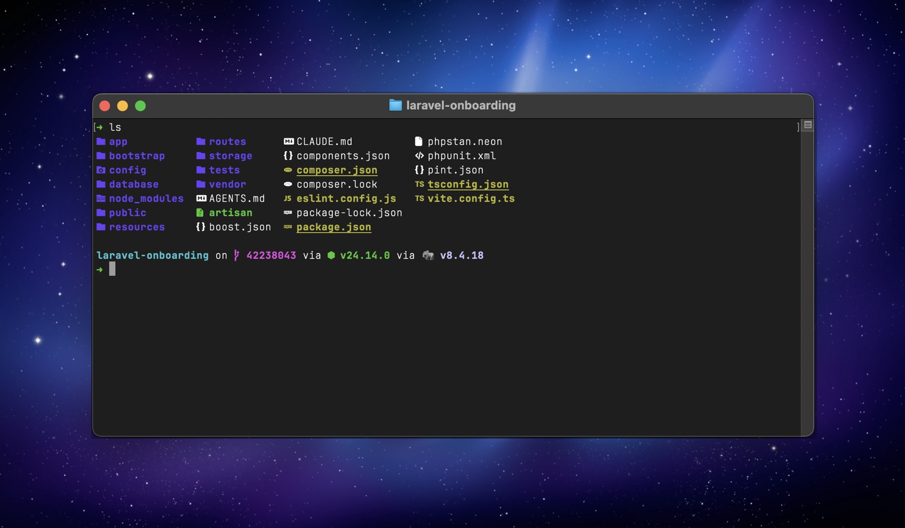
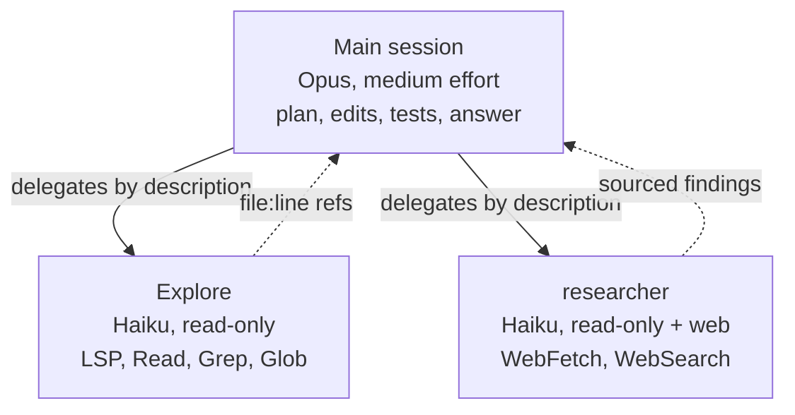

# My dotfiles



[](https://skills.sh/PickleBoxer/dotfiles)


macOS dotfiles for Laravel/PHP work: fast Rust CLI tools, a Starship prompt, and one shared AI setup for **Claude Code** and **Codex**.

**[Install](#install)** · **[Shell](#shell)** · **[Daily use](#daily-use)** · **[Dev stack](#dev-stack)** · **[AI setup](#ai-setup)** · **[Customize](#customize)** · **[Maintain](#maintain)**

---

## Install

```bash
# 1. SSH key (skip if you have one): creates ed25519, adds to keychain, copies pubkey
curl -fsSL https://raw.githubusercontent.com/PickleBoxer/dotfiles/main/ssh.sh | sh -s your@email.com

# 2. Clone and install (idempotent, safe to re-run)
git clone git@github.com:PickleBoxer/dotfiles.git ~/.dotfiles
git clone git@github.com:PickleBoxer/dotfiles-custom.git ~/.dotfiles-custom   # private, optional
cd ~/.dotfiles && bin/install
```

> [!TIP]
> Clone `dotfiles-custom` **before** `bin/install` so private skills and shell settings link on the first run. Later works too: the sync job picks it up within a minute.

> [!NOTE]
> Paste the copied key into [GitHub SSH settings](https://github.com/settings/ssh/new). Optional afterwards: `mackup restore` to restore app settings.

AI setup only, without the rest:

```bash
curl -fsSL https://raw.githubusercontent.com/PickleBoxer/dotfiles/main/bin/install-claude-code | bash
```

---

## Shell

| Tool                            | Replaces        | Why                                           |
| ------------------------------- | --------------- | --------------------------------------------- |
| [Starship](https://starship.rs) | Oh My Zsh       | Fast Powerline prompt, `config/starship.toml` |
| zoxide                          | z.sh / autojump | Frecency jumping, Rust speed                  |
| fzf                             |                 | Fuzzy files, history, dirs                    |
| direnv                          |                 | Per-directory env vars                        |
| fnm                             | nvm             | ~40x faster Node switching                    |
| bat                             | cat             | Syntax highlighting, git integration          |
| eza                             | ls              | Icons, tree view, git status                  |
| ripgrep                         | grep            | 5-10x faster, respects `.gitignore`           |
| fd                              | find            | Simpler syntax, ~10x faster                   |
| git-delta                       | diff            | Side-by-side, highlighted diffs               |
| bottom (`btm`)                  | top / htop      | Graphs, better UI                             |
| jq / yq                         |                 | JSON / YAML processing                        |

Nerd Fonts install via the Brewfile. QuickLook plugins preview code, markdown, JSON, CSV, patches, and archives in Finder.

<details>
<summary><b>Prompt git symbols</b></summary>

| Symbol | Meaning    |
| :----: | ---------- |
|  `!`   | Modified   |
|  `+`   | Staged     |
|  `?`   | Untracked  |
|  `✘`   | Conflicted |

Red segment on non-zero exit codes. Needs a Nerd Font with powerline glyphs.

</details>

<details>
<summary><b>Conductor terminal fallback</b></summary>

Conductor's terminal can't render Nerd Font glyphs. `.zshrc` and `.aliases` detect it (`$__CFBundleIdentifier` / `$CONDUCTOR_INTERNAL_BIN_DIR`) and switch automatically:

| Terminal            | Starship config              | `eza` icons |
| ------------------- | ---------------------------- | :---------: |
| Ghostty, iTerm, ... | `config/starship.toml`       |      ✓      |
| Conductor           | `config/starship-plain.toml` |      ✗      |

</details>

---

## Daily use

| Keys / command               | Does                                        |
| ---------------------------- | ------------------------------------------- |
| `z <dir>` · `zi`             | Jump to a frequent dir · interactive picker |
| <kbd>Ctrl</kbd>+<kbd>R</kbd> | Fuzzy history                               |
| <kbd>Ctrl</kbd>+<kbd>T</kbd> | Fuzzy file                                  |
| <kbd>Alt</kbd>+<kbd>C</kbd>  | Fuzzy `cd`                                  |
| `a` · `c` · `p`              | `php artisan` · `composer` · Pest/PHPUnit   |
| `mfs`                        | `php artisan migrate:fresh --seed`          |
| `nah`                        | `git reset --hard; git clean -df`           |
| `btm`                        | System monitor (aliased from `top`/`htop`)  |
| `bin/update`                 | Update dotfiles, Homebrew, npm, Composer    |

<details>
<summary><b>jq / yq examples</b></summary>

```bash
curl api.github.com/users/PickleBoxer | jq
cat composer.json | jq '.require'
php artisan tinker --execute="echo json_encode(User::first());" | jq
yq '.jobs' .github/workflows/ci.yml
yq -o json docker-compose.yml
```

</details>

---

## Dev stack

|                | Via      | Notes                                                                                       |
| -------------- | -------- | ------------------------------------------------------------------------------------------- |
| PHP + Composer | Homebrew | `brew upgrade php composer`                                                                 |
| Node.js        | fnm      | `fnm install --lts`, `fnm use 20`, `fnm list`                                               |
| **DDEV**       | Homebrew | Primary. Docker, per-project PHP, DB, services                                              |
| Laravel Valet  | Composer | Optional, lighter, one global PHP. `composer global require laravel/valet && valet install` |

Both can coexist. Prefer DDEV when a project needs a specific PHP version or services (MySQL, Redis, ...).

### DDEV commit signing

`bin/install` links `~/.gitconfig` and `~/.ssh/id_ed25519.pub` into `~/.ddev/homeadditions/` and adds the key to the host agent, so every container signs commits with your identity.

> [!IMPORTANT]
> After each reboot run `ddev auth ssh` to forward the agent into containers.

Custom SSH hosts inside containers (e.g. self-hosted GitLab): `~/.ddev/homeadditions/.ssh/config.d/custom.conf`.

### Packages

Everything lives in [`config/Brewfile`](config/Brewfile). Add a tool:

```bash
echo 'brew "tree"' >> ~/.dotfiles/config/Brewfile && brew bundle --file=~/.dotfiles/config/Brewfile
```

<details>
<summary><b>Full package list</b></summary>

| Group                        | Packages                                                                                                                                               |
| ---------------------------- | ------------------------------------------------------------------------------------------------------------------------------------------------------ |
| Core                         | node, php, php@8.4, composer, pkgconf, wget, ncdu, hub, gh, ack, doctl, 1password-cli, git-secret, imagemagick, yarn, ghostscript, mackup, mkcert, bun |
| Local dev                    | ddev, phpmon                                                                                                                                           |
| Apps                         | raycast, ghostty, google-chrome, slack, tableplus, visual-studio-code, dbngin, github, httpie-desktop, imageoptim, tinkerwell, the-unarchiver, vlc     |
| Modern CLI                   | starship, zoxide, bat, eza, ripgrep, fd, git-delta, fnm, fzf, direnv, jq, yq, bottom, mas, tree, trash, uv, coreutils, gnu-sed, bash                   |
| Zsh                          | zsh-autosuggestions, zsh-syntax-highlighting                                                                                                           |
| Fonts                        | font-meslo-lg-nerd-font, font-jetbrains-mono(-nerd-font), font-fira-code(-nerd-font), font-open-sans, font-roboto, font-bitter, font-lato              |
| QuickLook                    | qlmarkdown, betterzip, suspicious-package                                                                                                              |
| PHP extensions _(prompted)_  | imagick, memcached, xdebug, redis                                                                                                                      |
| Global Composer _(prompted)_ | laravel/pint, laravel/envoy, laravel/installer, spatie/phpunit-watcher                                                                                 |

</details>

---

## AI setup

One source in `config/claude/`, read by both Claude Code and Codex. Nothing is duplicated per tool.

```
config/claude/
├── AGENTS.md       instructions, read natively by both harnesses
├── settings.json   Claude Code settings, permissions, hooks
├── rules/          always-loaded rules (commit conventions)
├── agents/         custom subagents
└── skills/         10 skills + 2 bundled plugins
```

### Skills

| Area             | Skills                                                                                                                           |
| ---------------- | -------------------------------------------------------------------------------------------------------------------------------- |
| Laravel / PHP    | `spatie-guidelines` · `spatie-package-skeleton` · `laravel-inertia-react-structure` · `livewire-4` · `speeding-up-laravel-tests` |
| Review & quality | `review-code` · `review-pr` · `audit-architecture` · `test-audit`                                                                |
| Tools            | `code-snippet-images`                                                                                                            |
| Plugins          | `laravel-lsp` (on) · `marketing` (29 skills, off by default)                                                                     |

<details>
<summary><b>What each skill does</b></summary>

- `spatie-guidelines`: Spatie's PHP, Laravel, JS, and Vue conventions
- `spatie-package-skeleton`: scaffold Spatie-style packages
- `laravel-inertia-react-structure`: frontend structure for Inertia + React
- `livewire-4`: Livewire 4 components and apps
- `speeding-up-laravel-tests`: diagnose slow Pest suites
- `review-code` / `review-pr`: multi-lane review, see [Review workflow](#review-workflow)
- `audit-architecture`: read-only multi-agent architecture audit
- `test-audit`: gate for new tests, audit for low-value ones
- `code-snippet-images`: code screenshots for social and docs

</details>

**Adding one:** `npx skills add <owner/repo>`, then commit `config/claude/skills/`. Browse at [skills.sh](https://skills.sh).

> [!TIP]
> The **name and description** decide whether a skill ever triggers, so write them around the phrases you'd type. Keep the body short and push detail into `references/`, which loads only on demand.

### Agents



- `Explore` replaces the built-in one with a Haiku agent that prefers LSP over grep
- `researcher` handles docs, changelogs, and web lookups
- `laravel-feature-builder` implements full Laravel features
- Pass `model: "opus"` per call when a search needs judgment
- PHP simplification comes from `laravel-simplifier` (`laravel@laravel` plugin), not a local agent

### Code intelligence

| Server                   | Files        | Gives                                              | Install                                          |
| ------------------------ | ------------ | -------------------------------------------------- | ------------------------------------------------ |
| `php-lsp` (Intelephense) | `.php`       | Types, references, signatures                      | `npm i -g intelephense`                          |
| `laravel-lsp`            | `.blade.php` | Routes, config keys, views, translations, bindings | `composer global require laravel/lsp`            |
| `typescript-lsp`         | `.ts` `.tsx` | TS intelligence                                    | `npm i -g typescript-language-server typescript` |

> [!NOTE]
> Claude Code allows **one server per file extension**. To let Laravel LSP own `.php`, disable `php-lsp` and add `".php"` to `skills/laravel-lsp/.lsp.json`. Its `phpEnvironment: auto` finds Herd and Valet.

### Review workflow

`review-code` and `review-pr` share [`lanes.md`](config/claude/skills/review-code/references/lanes.md): six lanes in parallel.

|  #  | Lane               | Runs               | Needs                                                  |
| :-: | ------------------ | ------------------ | ------------------------------------------------------ |
|  1  | Correctness        | always             | `/code-review` (`code-review@claude-plugins-official`) |
|  2  | PHP simplification | PHP changed        | `laravel-simplifier` agent (`laravel@laravel`)         |
|  3  | Spatie conventions | always             | `spatie-guidelines`                                    |
|  4  | Laravel practices  | if Boost installed | `laravel-best-practices` (per repo, via Laravel Boost) |
|  5  | React              | JS/TS changed      | `vercel-react-best-practices`                          |
|  6  | Security           | always             | `/security-review` (built in)                          |

Priority: **security > correctness > conventions**. Defect findings need a concrete failure scenario. `review-pr` also needs `pr-review-toolkit@claude-plugins-official`. `lanes.md` has a per-harness table, so it runs under Codex too.

<details>
<summary><b>Settings, plugins, and per-project scoping</b></summary>

`config/claude/settings.json` → `~/.claude/settings.json`, shared by every project.

| Key                                                         | Purpose                                                                                                               |
| ----------------------------------------------------------- | --------------------------------------------------------------------------------------------------------------------- |
| `permissions`                                               | `allow` / `deny` / `ask` lists, `defaultMode: auto`. Denies e.g. `git commit`, asks before reading `~/.ssh` or `.env` |
| `enabledPlugins`                                            | Toggle whole plugins (`php-lsp`, `typescript-lsp`, `mattpocock-skills`, ...)                                          |
| `skillOverrides`                                            | Per loose skill: `on` · `name-only` · `user-invocable-only` · `off`                                                   |
| `autoMode`                                                  | Machine-specific context for auto mode. Don't copy between repos                                                      |
| `effortLevel` `fastMode` `spinnerVerbs` `cleanupPeriodDays` | Misc tuning                                                                                                           |

**Bundled plugins.** `config/claude/skills/` is also a local marketplace, `dotfiles-skills` (`.claude-plugin/marketplace.json`, registered in `extraKnownMarketplaces`). A folder with its own `.claude-plugin/plugin.json` is a plugin and needs a `marketplace.json` entry. Launch the CLI from the repo root so project-scope plugins load.

**Scoping.** Both keys work in any settings file, and list entries merge:

| Scope              | File                                 |
| ------------------ | ------------------------------------ |
| User, all projects | `~/.claude/settings.json`            |
| Project, committed | `<repo>/.claude/settings.json`       |
| Project, just you  | `<repo>/.claude/settings.local.json` |

```json
// <repo>/.claude/settings.json
{
  "skillOverrides": { "test-audit": "off" },
  "enabledPlugins": {
    "swift-architecture-skill@swift-architecture-skill": true
  }
}
```

The Swift plugins (`swift-architecture-skill`, `swift-concurrency-agent-skill`, `swiftui-agent-skill`, `swift-testing-agent-skill`) use exactly this: off globally, on per repo.

> [!WARNING]
> `skillOverrides` only affects loose skills. Plugin skills like `marketing` are toggled with `enabledPlugins`.

</details>

<details>
<summary><b>Sharing with Codex</b></summary>

|              | Claude Code                    | Codex                                     |
| ------------ | ------------------------------ | ----------------------------------------- |
| Instructions | `~/.claude/AGENTS.md`          | `~/.codex/AGENTS.md`                      |
| Skills       | `~/.claude/skills` (whole dir) | `~/.agents/skills/*` (one link per skill) |
| Invoke       | `/review-code`                 | `$review-code`                            |

`bin/install-agent-skill-sync` installs a LaunchAgent (`dev.maticvertacnik.agent-skill-sync`) that runs at login, watches the skills dir, and rechecks every 60s. It links every dir with a top-level `SKILL.md`, cleans up removed ones, backs up conflicting installs to `~/.agents/backups/link-agent-skills.*`, and leaves unrelated skills alone. `bin/install-claude-code` sets it up on new machines.

- Run now: `bin/link-agent-skills`
- Logs: `~/Library/Logs/dev.maticvertacnik.agent-skill-sync.log`
- Skill missing in Codex? Restart it.

</details>

---

## Customize

| What                                          | Where                                              |
| --------------------------------------------- | -------------------------------------------------- |
| Private aliases, functions, exports, `.zshrc` | `~/.dotfiles-custom/shell/` (auto-loaded)          |
| Private skills                                | `~/.dotfiles-custom/claude/skills/<name>/SKILL.md` |
| Per-project env vars                          | `.envrc` + `direnv allow`                          |

<details>
<summary><b>How private skills work</b></summary>

`bin/link-private-skills` symlinks each one into `config/claude/skills/` and adds it to `.git/info/exclude`, so both harnesses load it while git never sees it. The exclude file is local, so names stay private and nothing conflicts with upstream. It runs first in `bin/link-agent-skills`, so the sync job keeps it current. A private skill never replaces a tracked one with the same name.

```bash
mkdir -p ~/.dotfiles-custom/claude/skills/my-skill
vim ~/.dotfiles-custom/claude/skills/my-skill/SKILL.md
~/.dotfiles/bin/link-private-skills   # or wait up to a minute
```

</details>

---

## Maintain

<details>
<summary><b>What gets symlinked</b></summary>

| `~/`                                                    | → `~/.dotfiles/`                        |
| ------------------------------------------------------- | --------------------------------------- |
| `.zshrc` · `.gitconfig` · `.global-gitignore`           | `home/`                                 |
| `.mackup.cfg`                                           | `macos/`                                |
| `.claude/{skills,agents,rules,settings.json,AGENTS.md}` | `config/claude/`                        |
| `.codex/AGENTS.md`                                      | `config/claude/AGENTS.md`               |
| `.agents/skills/*`                                      | `config/claude/skills/*`                |
| `.config/ghostty/{config,themes}`                       | `config/ghostty/`                       |
| `bin/php-format`                                        | `bin/php-format`                        |
| `.ddev/homeadditions/{.gitconfig,.ssh/id_ed25519.pub}`  | `~/.gitconfig`, `~/.ssh/id_ed25519.pub` |

Sourced by `.zshrc`, not linked: `home/.aliases`, `home/.functions`, `home/.exports`.

</details>

<details>
<summary><b>Scripts in <code>bin/</code></b></summary>

| Script                     | Does                                                                                                             |
| -------------------------- | ---------------------------------------------------------------------------------------------------------------- |
| `install`                  | Full setup, idempotent                                                                                           |
| `install-claude-code`      | AI setup only: CLI, symlinks, Codex links                                                                        |
| `update`                   | Update dotfiles, Homebrew, npm, Composer                                                                         |
| `doctor`                   | Health check                                                                                                     |
| `link-agent-skills`        | Link skills and `AGENTS.md` into Codex                                                                           |
| `link-private-skills`      | Link private skills, excluded from git                                                                           |
| `install-agent-skill-sync` | Background job keeping skill links current                                                                       |
| `conductor-merge`          | Fast-forward the Conductor workspace branch into `main`. `--push` also pushes, clearing Conductor's Changes view |
| `exclude-from-spotlight`   | Drop `.metadata_never_index` in data-heavy dirs so `mds_stores` stays idle                                       |

</details>

<details>
<summary><b>Syncing from upstream (freekmurze/dotfiles)</b></summary>

`main` merges `upstream/main`, so merge commits record which upstream commits are handled.

**One-time setup**

```bash
git remote add upstream git@github.com:freekmurze/dotfiles.git
git remote set-url --push upstream no_push   # never push upstream
git config rerere.enabled true               # remember resolutions
git config merge.conflictStyle zdiff3        # show common ancestor
```

**Each sync**

```bash
git fetch upstream && git log --oneline main..upstream/main   # empty = up to date
git switch -c sync/upstream main && git merge upstream/main   # resolve, reload shell, test
git switch main && git merge --ff-only sync/upstream && git branch -d sync/upstream && git push origin main
```

**Skip an unwanted commit:** merge up to the one before it, then mark it handled:

```bash
git merge <hash-before-unwanted>
git merge -s ours <unwanted-hash> -m "chore(upstream): skip <reason>"
```

Or merge everything and `git revert` what you don't want.

| Query                                               | Shows                   |
| --------------------------------------------------- | ----------------------- |
| `git log --oneline main..upstream/main`             | Upstream not merged yet |
| `git log --oneline --no-merges upstream/main..main` | Your customizations     |
| `git log --oneline --first-parent main`             | One line per sync       |

> [!TIP]
> Keep personal changes in files upstream never touches (see [Customize](#customize)) to keep conflicts rare.

</details>

---

Created by [Freek Van der Herten](https://github.com/freekmurze), used by many at [Spatie](https://spatie.be).
